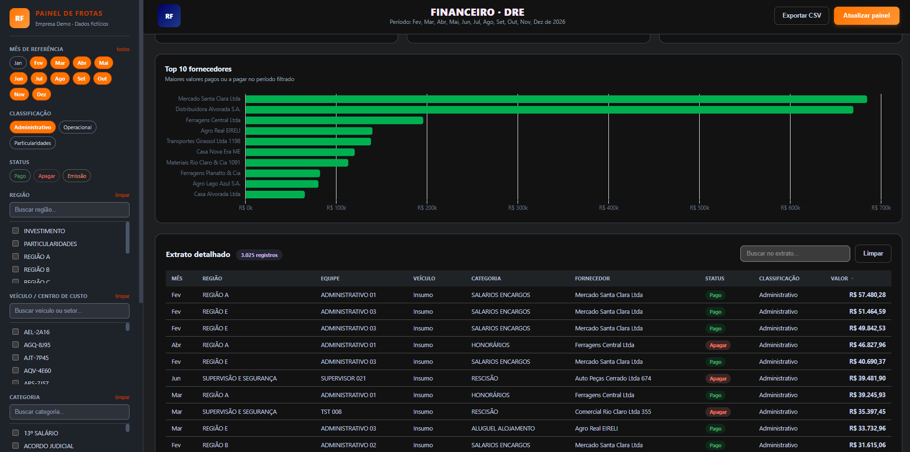
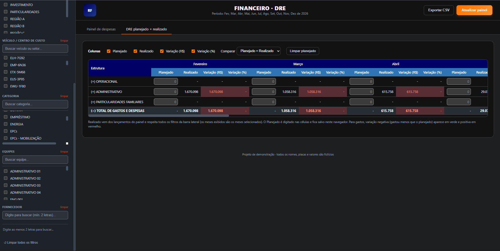
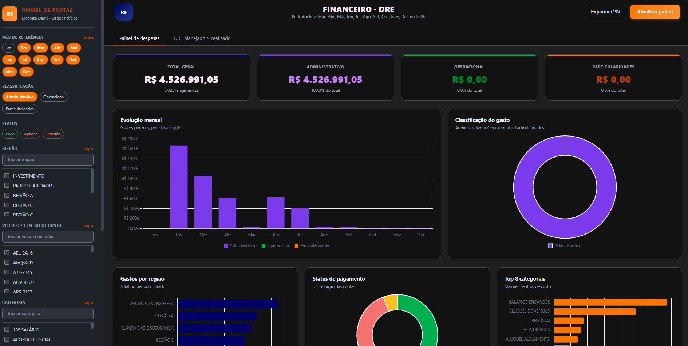

# Integrated Financial DRE & Fleet Expense Dashboard 📊🚚

An enterprise-grade operational intelligence dashboard that unifies daily expense logging, fleet management controls, and an interactive Budget Statement (Planned vs. Actual) with automated compliance auditing.

> **Status:** Completed Prototype 🚧 (Sample & Demo data only)

## 🖥️ System Interface & Analytics

### 1. Unified Budgetary Control Panel (DRE)
Features real-time comparative structures tracking company performance across custom operational timeframes.

### 2. Operational Variance Engine (Planned vs. Actual)
Executes instant currency ($) and percentage (%) deviation analyses. Includes conditional UI formatting: **Green** for favorable budget tracking (savings) and **Red** for overspending.

### 3. Granular Ledger Audit System
A structured financial data grid optimized for auditing deep metrics like Month, Region, Team, Asset plates, Category, and Final Values.

---

## 💡 Key Architectural Features
- **Fleet Asset Tracking:** Relational matrix enabling operational managers to completely isolate logistics costs per individual vehicle license plate.
- **Role-Based Compliance Data:** Segregated visualization pipelines—operational sectors focus strictly on localized departmental entries, while board directors audit global analytics.
- **Smart Data Persistence:** Daily operational expenses dynamically compute on-the-fly, while strategic monthly targets can be inputted locally and preserved via local browser environment mechanics.

## 🛠️ Tech Stack
- **Frontend Core:** Semantical HTML5 & Responsive layouts.
- **Styling Architecture:** Pure CSS3 containing advanced structural grid systems and conditional visual states.
- **Calculation Engine:** Vanilla JavaScript handling multi-level functional matrices and real-time ledger outputs (EBITDA, Net Revenue, Contribution Margin) without external frameworks.

---
*Developed by Larissa Souza — Open to global remote roles in IT Support, Infrastructure, and Automation.*
