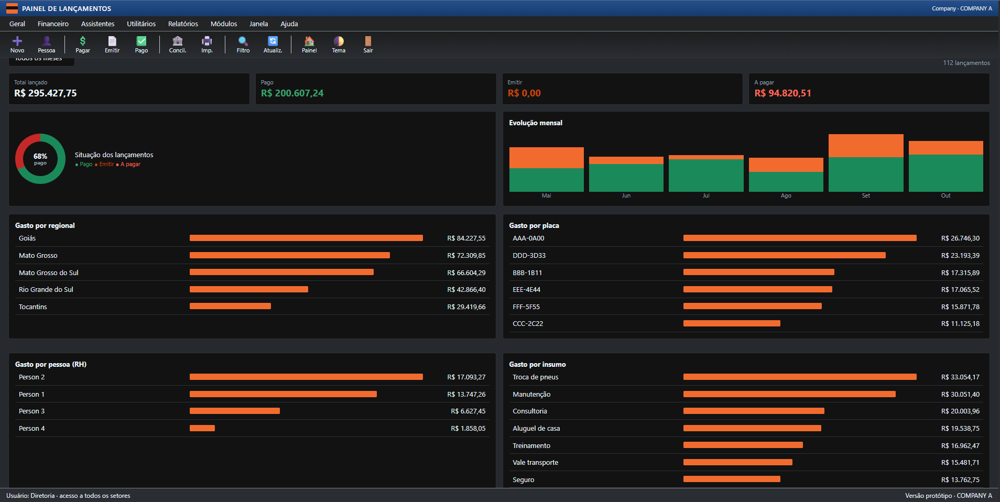
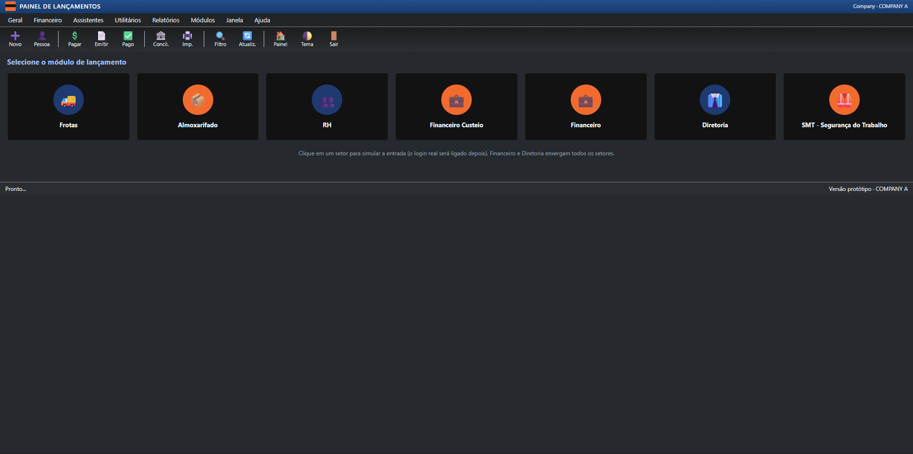

# Expense Entry Panel 📊💸

An administrative dashboard built to log, filter, and track corporate expenses by department (fleet, HR, finance, etc.).

## 🖥️ System Interface

### Financial Dashboard & Analytics

### Role-Based Sector Selection

### Expense Table by Department

> **Status:** Prototype 🚧

## 🛠 Tech Stack
- HTML5, CSS3, and JavaScript

## 💡 Key Features
- **Role-Based Simulation:** Allows switching between profiles to test view permissions.
- **Data Privacy:** Financial managers and board members can audit all entries, while operational sectors only see their respective department logs.
- **Interactive Tables:** Filter expenses by supplier, date range, or sort by costs.
