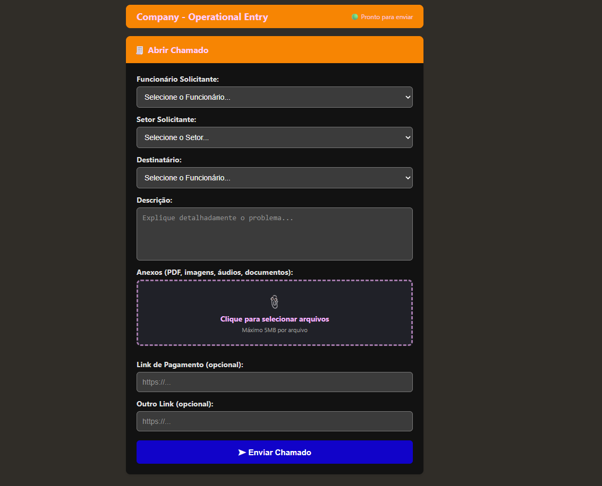
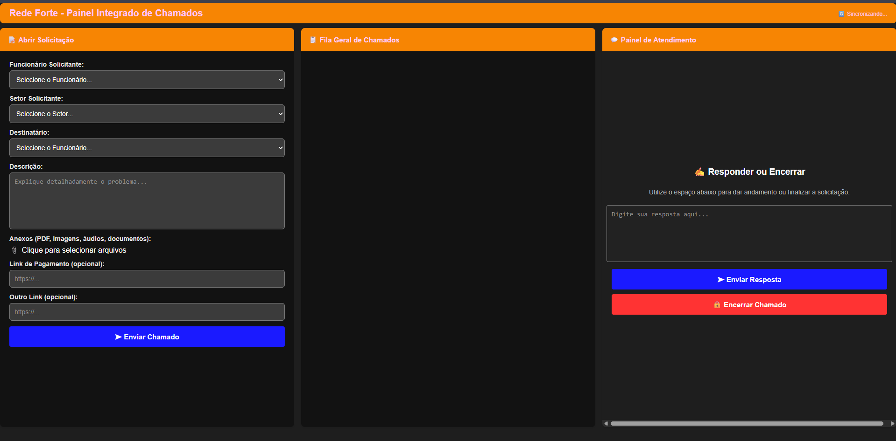

# Helpdesk Ticket Form & Admin Panel 🧾🤖

A web-based internal ticketing system built to centralize corporate technical requests, prevent communication gaps, and streamline support workflows.

## 🖥️ System Interface

### Employee Submission Form

### Integrated Ticket Queue & Admin Panel

> **Status:** In progress 🚧

## 🛠 Tech Stack
- **Frontend**: HTML5 & CSS3 (Custom Responsive Dark/Orange UI)
- **Logic**: Vanilla JavaScript
- **Database**: Firebase Realtime Database (via REST API integrations)

## 💡 Key Features
- **Department Routing:** Requesters can select their names and target operational areas efficiently.
- **Attachment Support:** Native support for handling file uploads (PDFs, images, logs, documents).
- **Live Ticket Queue:** Administrative view featuring live queue counters, open status logs, and instant resolution/reply capabilities.
