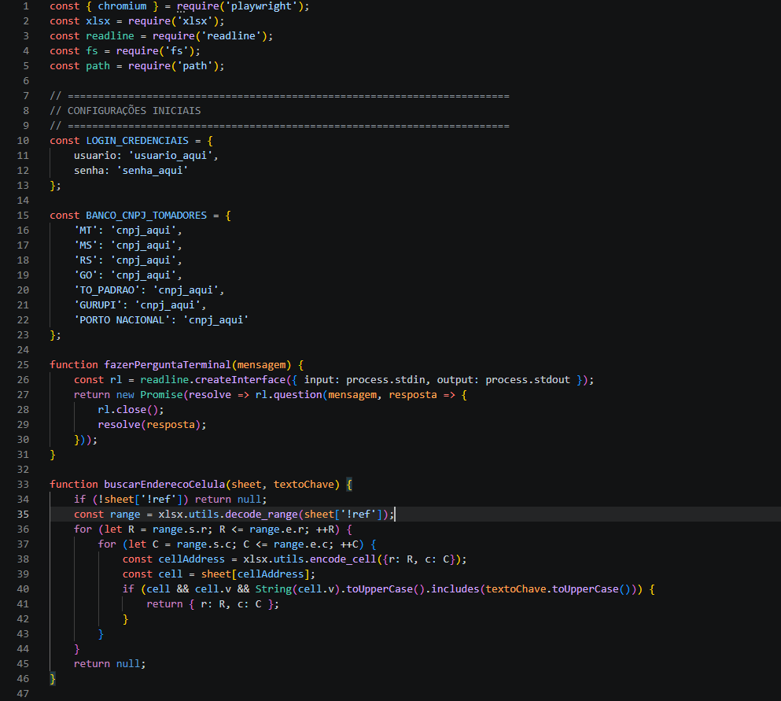
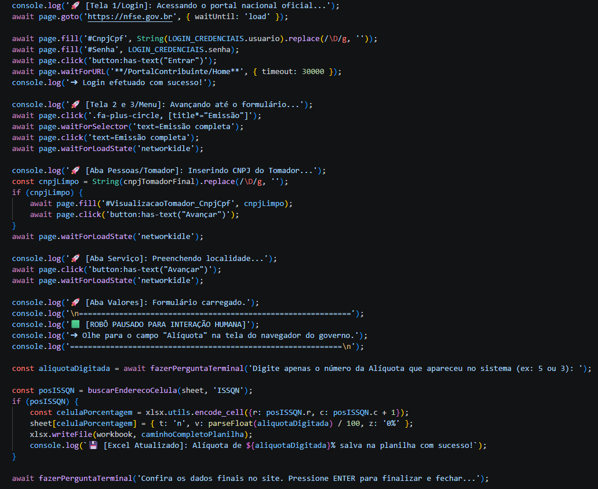

# National Service Invoice Assistant (RPA Robot) 🤖💼

An automated Robotic Process Automation (RPA) script engineered to eliminate manual, repetitive workloads when issuing national service invoices (NFS-e) through official government portals.

## 🖥️ System Architecture & Source Code

### 1. Variables Management & Data Parsing
Features secure parameter loading, dynamic accounting logic mappings, and structural Excel (`xlsx`) coordinate lookups.

### 2. Browser Automation Engine & Hybrid Human-in-the-Loop Workflow
Handles live browser manipulation (Playwright), dynamic regex masking (`.replace(/\D/g, '')`), government portal selector monitoring, and an engineered stateful pause allowing human-in-the-loop validation for tax rates.

---

## 💡 System Intelligence & Business Logic
Unlike static scripts, this robot uses advanced workflows to dynamically process secure accounting pipelines:
- **Dynamic Ledger Data:** Built-in capability to parse local file structures to automate bulk submissions safely.
- **Spreadsheet Automation:** Integrates smoothly with Excel systems (`xlsx` library) to read data matrices, map keys, and inject variables back into spreadsheet cells dynamically upon success.

## 🛠️ Tech Stack
- **Node.js**: Asynchronous server runtime environment.
- **Playwright**: Modern end-to-end browser automation framework.
- **XLSX (SheetJS)**: Advanced spreadsheet reading and ledger parsing.
- **Dotenv**: Secure separation of application code from sensitive environment parameters.

## 🎛️ Key Technical Architecture
- **Data Protection (Security First):** Corporate registry credentials, passwords, and sensitive keys are decoupled from the core script and safely loaded via local environment variables (`.env`).
- **Resilient Waiting Mechanisms:** Built with native try/catch defensive blocks, custom readline shell terminals, and dynamic event listeners (`networkidle`) to handle slow or unstable government endpoints.
